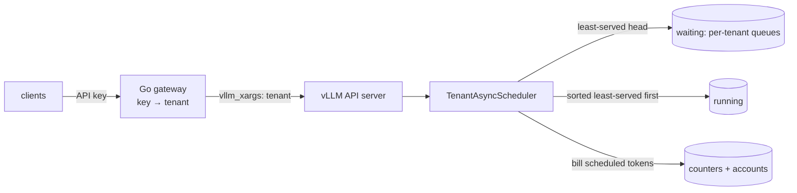

# fairsched: fair multi-tenant scheduling for vLLM

**Problem.** Tenants that share one vLLM engine are served in proportion to
what they send. Under vLLM's FCFS, a 300-request burst from one tenant pushed
another tenant's median time to first token (TTFT) to 29–41 s, and a tenant
sending three times the other's demand took 75% of the service. Static priority
helps only if you know in advance who is interactive; between peers it gives
one tenant everything.

**Approach.** fairsched is an out-of-tree scheduler plugin for vLLM 0.31.0
that implements the Virtual Token Counter (VTC; Sheng et al., *Fairness in
Serving Large Language Models*, OSDI 2024). It orders admission and each
step's token budget by the weighted service each tenant has received, bills
only the tokens that actually ran, and never preempts a request on its own.
A small Go gateway maps API keys to tenants.

**Results** (Qwen2.5-7B on one RTX 4090; ranges over 5 seeds):
- **Peers split evenly.** With both tenants backlogged and one sending three
  times the other's demand, VTC splits service 0.50 : 0.50 (FCFS 0.25 : 0.75,
  static priority 1.00 : 0.00 either way). *Cost:* 0.5–1.1% lower throughput
  than FCFS, with more preemption recompute.
- **A burst does not starve interactive traffic.** During the 300-request
  burst, the interactive tenant's median TTFT is 0.39–0.50 s, against
  28.8–40.5 s under FCFS. *Cost:* VTC is not the fastest option for that
  tenant. Static priority, told who is interactive, is 1.5–1.8× faster on the
  median; a per-tenant concurrency cap of 16 at the gateway is 4–5× faster,
  though with a 2–2.4× higher p99 and the burst finishing 28–30 s later. VTC
  also exposes the interactive tenant to 8–20 KV-pressure preemptions (0–8
  under FCFS). An optional victim order brings that to 0, but does not lower
  the tenant's latency.
- **The plugin is cheap.** On a saturating trace, vLLM with the plugin in
  passthrough mode delivers 0.1–0.5% less throughput than without it, seed
  for seed. *Cost:* VTC gives up another 0.7% and recomputes more after
  preemptions, and the hooks add 132–403 µs of CPU per scheduling step at
  64–256 running requests.

The limits, including that light-tenant preemption and an evaluation on one
GPU, one model and synthetic traces, are under [Limitations](#limitations).

## What is in this repository

The work here is the integration and the evaluation:
- where to hook a continuous-batching scheduler that has chunked prefill,
  async scheduling, prefix caching and KV-pressure preemption, without
  modifying vLLM;
- how to bill only the work that actually ran;
- a post-mortem of an earlier design that livelocked;
- repeated-seed experiments on an RTX 4090 that report VTC's costs as well as
  its wins, against vLLM's FCFS and priority policies and a gateway
  concurrency cap.

## How it works

The plugin subclasses vLLM's `AsyncScheduler` and loads with
`--scheduler-cls fairsched.TenantAsyncScheduler`. It hooks the scheduler in
three places ([docs/design.md](docs/design.md); the decisions and their costs
are in [docs/design-tradeoffs.md](docs/design-tradeoffs.md)):

1. **Admission.** `self.waiting` becomes a per-tenant queue. Each pop returns
   the oldest request of the least-served tenant, the one with the lowest
   virtual counter. A tenant that returns after its queue emptied is lifted
   to the lowest counter among backlogged tenants, as in the paper, so idle
   time cannot be banked.
2. **Token budget and preemption victim.** Before vLLM's native `schedule()`
   runs, the running list is sorted least-served first.
   - vLLM spends each step's token budget in that order.
   - Under KV pressure vLLM preempts `running[-1]`. That is now the newest
     request of whichever tenant is most over-served at that moment, which
     can be the light tenant right after a lift (see the costs below). The
     `kv_share` option takes the victim from a tenant over its share of the
     KV instead ([below](#choosing-the-preemption-victim-by-kv-share)).
3. **Billing.** `_update_after_schedule` charges each tenant, before positions
   advance, for the tokens vLLM actually scheduled that step:
   - prefill tokens at weight 1, decode tokens at weight 2;
   - prefix-cache hits are never billed;
   - recompute after a preemption is detected from executed positions and
     billed to a separate `system` account;
   - steps of requests aborted while their step was on the GPU are
     reclassified as wasted.

The plugin never preempts a request on its own. An earlier design did, and
on a deliberately overloaded run with 6,144-token prompts it **livelocked**:
- no request produced a token before the 90 s client timeout;
- in the part of the run its step log covers, the policy preempted 678 times
  and 99.5% of the prefill tokens it dispatched recomputed positions already
  computed once.

Plain FCFS also timed out on that workload with the same limits, so the run
shows where the policy's work went, not that FCFS would have finished. [docs/livelock.md](docs/livelock.md) explains
why enforcing fairness below the size of one request destroys work.

## Results

**Setup**
- One RTX 4090, Qwen2.5-7B-Instruct BF16, vLLM 0.31.0 in its official
  container, with async scheduling and prefix caching.
- Engine limits: `--max-num-batched-tokens 2048`, `--max-num-seqs 128`, and
  84k tokens of KV.
- Load: the Go load generator replays seeded open-arrival traces through the
  gateway. Prompts are exact-length token IDs, and `ignore_eos` fixes output
  lengths.
- `noisy_neighbor` and `aggressive` ran with 5 seeds per arm (seeds 4 and 5
  in a later session than 1–3), the other workloads and arms with 3. In
  `noisy_neighbor` and `long_prompt` the
  seed changes tenant A's Poisson arrival times (and, in `noisy_neighbor`,
  which of B's requests are cancelled). In `aggressive` and `weighted` the
  arrival schedule is fixed and the seed changes only the prompt token IDs.
  Tables give the range over seeds.
- Percentiles are nearest-rank over each run's completed requests. Where a
  tenant has fewer than 100 requests (A in `long_prompt` has 63–69), p99 is
  the maximum.
- Arms:
  - **FCFS:** vLLM's scheduler with the plugin in passthrough mode, so
    accounting and logging match the VTC arm;
  - **FCFS + gateway cap** (noisy neighbour only): FCFS as above, with the
    gateway admitting at most 16 requests per tenant to the engine and
    queueing the rest (its `max_inflight`). 16 of B's requests hold about 37k
    tokens, under half of the KV cache. Only this one cap value was run;
  - **priority:** vLLM's native priority policy, with the gateway marking one
    tenant high;
  - **VTC;**
  - **no plugin** (overhead runs only): vLLM's FCFS without the plugin.
- "Share" is each tenant's fraction of billed service over the steps in
  which both tenants had work waiting.
- Per-run data is in `results/*/summary.json`
  ([results/README.md](results/README.md)). To rerun, see
  [Reproduce](#reproduce).

### Noisy neighbour

**Workload.**
- Tenant A: Poisson 2 req/s, 256-token prompts, 128 output tokens, for 120 s.
- Tenant B: at t = 10 s, 300 requests with 2,048-token prompts and 256 output
  tokens. The client cancels a random 20% of them after their second output
  chunk.

| | FCFS | FCFS + gateway cap | Priority (A high) | VTC |
|---|---|---|---|---|
| A TTFT median | 28.8 – 40.5 s | 0.09 – 0.10 s | 0.23 – 0.30 s | 0.39 – 0.50 s |
| A TTFT p99 | 89.5 – 92.0 s | 2.05 – 2.94 s | 0.70 – 0.78 s | 0.86 – 1.43 s |
| B TTFT median | 41.0 – 46.3 s | 63.9 – 65.1 s | 48.0 – 50.2 s | 48.4 – 50.2 s |
| B's burst finishes | 112 – 115 s | 142 – 147 s | 113 – 116 s | 113 – 118 s |
| A requests preempted under KV pressure | 0 – 8 | 0 | 0 | 8 – 20 |

The gateway-cap column has 3 seeds, the others 5.

Under FCFS, A gets almost no service from t = 10 s until B's backlog drains
near t = 100 s. Under VTC, A is served at its demand throughout. B pays with
2.4–8.0 s more median TTFT than under FCFS, and its burst finishes 0.6–2.7 s
later (same seed):

**A concurrency cap at the gateway** is the obvious alternative to a
scheduler. With each tenant limited to 16 requests in the engine (run later
than the other arms, on the same traces), it beats VTC on two counts: A's
median TTFT is 0.09–0.10 s, and nothing is preempted. It loses on the
others. A's p99 is 2.05–2.94 s against VTC's 0.86–1.43 s. With at most 16 of
B's requests running, B's median TTFT rises to 63.9–65.1 s and its burst
finishes at 142–147 s, 28–30 s later than under VTC with the same seed, so
the same work takes longer (625–661 output tokens/s over the run, against
731–802 for the other arms). The cap is also a number that has to suit the
workload and the KV cache; only one value was tried here.

The preemption row is VTC's cost. Each time A's queue empties and a new
request arrives, the lift puts A level with B's counter. For a moment A can
then be the most-served tenant, and after the sort vLLM's KV-pressure victim
is always the newest request of the most-served tenant. They are not what
keeps A's p99 above priority's, though: removing them with the `kv_share`
order (next section) left A's TTFT where it was.

### Choosing the preemption victim by KV share

With `preempt_order: "kv_share"` in the policy (arm `vtc-kv`), tenants
holding more than their weighted share of the running requests' KV (counted
as computed tokens) go to the back of `running`, keeping counter order inside
each group. vLLM's victim is then the newest request of the highest-counter
tenant among them, so a light tenant within its share is not preempted while
a heavier one is running. The plugin still never preempts on its own. Both
orders ran in one session, 3 seeds each (`results/kv_victim_*`):

| | Noisy neighbour, counter | Noisy neighbour, kv_share | Aggressive, counter | Aggressive, kv_share |
|---|---|---|---|---|
| A requests preempted | 7 – 15 | **0** | 16 | 11 – 16 |
| B requests preempted | 28 – 31 | 33 – 38 | 56 | 50 – 55 |
| A TTFT median | 0.41 – 0.51 s | 0.33 – 0.56 s | 16.4 s | 16.3 – 16.5 s |
| A TTFT p99 | 0.95 – 1.65 s | 0.95 – 1.73 s | 33.3 s | 32.6 – 32.8 s |
| A : B share | 0.28 – 0.31 : 0.69 – 0.72 | 0.29 : 0.71 | 0.50 : 0.50 | 0.50 : 0.50 |
| Output tokens/s | 731 – 802 | 731 – 802 | 1,304 – 1,306 | 1,310 – 1,311 |
| Recompute billed to `system` | 36.1k – 40.6k | 35.7k – 42.8k | 68.0k | 64.5k |

- In the noisy-neighbour workload the light tenant is no longer preempted,
  and B absorbs 4–8 more preemptions per seed. A's TTFT does not improve: its
  p99 is the same in two seeds and 0.08 s higher in the third.
- In the aggressive workload both tenants are backlogged peers, so A is
  sometimes over its KV share and still loses requests. Throughput is
  0.3–0.5% higher per seed, with 5% less recompute.
- The order also changes who gets the step's token budget first: an
  over-share tenant's running requests now come after everyone else's.

The default stays `counter`. `kv_share` moves preemptions from the light
tenant to the heavy one without a measured latency gain, and every other
result here uses the default.

### Aggressive tenant

**Workload.** Both tenants are backlogged from t = 0 with the same request
shape: 1,024-token prompts and 256 output tokens. A sends 100 requests and B
sends 300, three times the demand. The weights are equal.

| | FCFS | Priority (A high) | Priority (B high) | VTC |
|---|---|---|---|---|
| A : B share | 0.25 : 0.75 | 1.00 : 0.00 | 0.00 : 1.00 | **0.50 : 0.50** |
| A TTFT median / p99 | 32.6 / 72.0 s | 4.8 / 16.1 s | 61.0 / 72.4 s | 16.5 / 33.3 s |
| A's last request finishes | 77.9 – 78.5 s | 29.2 – 29.5 s | 77.8 – 78.6 s | 46.3 – 46.8 s |
| B's last request finishes | 77.9 – 78.5 s | 77.7 – 78.2 s | 68.6 – 69.4 s | 78.4 – 79.1 s |
| Output tokens/s (median) | 1,309 | 1,312 | 1,314 | 1,295 |

TTFT cells are medians over the 5 seeds; no cell varied by more than 0.9 s
across seeds. VTC's throughput is 0.5–1.1% below FCFS's with the same seed.
- **FCFS** serves each tenant in proportion to what it sends.
- **Static priority** is all or nothing between peers.
- **VTC** splits service evenly until A runs out of work, then gives B
  everything.

The throughput cost comes with extra preemption recompute. Alternating
between two backlogged tenants churns the KV cache: VTC billed 68.0k–69.5k
weighted tokens of recompute to `system`, against 59.4k–63.8k for FCFS.

### Weighted shares

**Workload.** Each tenant has 200 identical requests backlogged from t = 0. A
has weight 2, B weight 1.

| | FCFS | VTC |
|---|---|---|
| A : B share | 0.50 : 0.50 | **0.67 : 0.33** (target 0.667) |
| A TTFT median | 32.6 – 33.4 s | 25.2 – 28.4 s |
| B TTFT median | 32.7 – 33.4 s | 56.3 – 58.0 s |
| Output tokens/s (median) | 1,304 | 1,278 (−2.0%) |

Here the cost is larger. VTC preempted 72–87 requests against FCFS's 68–70,
and recomputed 74.8k–90.3k weighted tokens against 59.4k–63.8k.

### Different request shapes, and what a token costs

**Workload.** Both tenants are backlogged from t = 0 with equal weights but
different shapes. A sends 200 prefill-heavy requests (2,048-token prompts,
32 output tokens), B 200 decode-heavy ones (128-token prompts, 512 output
tokens). 3 seeds per arm, all in one session (`results/mixed_shapes/`).

VTC's share is in its own billing units, prefill tokens at weight 1 and
decode tokens at 2. To see what the GPU actually spent, `bench/gpu_time.py`
fits each step's wall time to the work the step log records for it:

    step time = c0 + cq · (query tokens run as prefill) + cd · (decode steps) + ca · (causal attention pairs)

With async scheduling a step is logged while the one before it is still on
the GPU, so the fit pairs step k's work with the interval between the next
two log records. That alignment fits with R² = 0.997 and a median error of
0.54 ms over 29,744 steps; pairing with the same or later intervals gives
R² 0.63–0.68. Each step's time is then split between tenants in proportion
to their predicted variable cost (the fixed c0 is shared the same way).

| | FCFS | FCFS + gateway cap | VTC | VTC, kv_share |
|---|---|---|---|---|
| A : B share, billed (VTC units) | 0.72 : 0.28 | see below | **0.50 : 0.50** | 0.50 : 0.50 |
| A : B share, fitted GPU time | 0.76 : 0.24 | see below | 0.53 – 0.54 : 0.46 – 0.47 | 0.54 : 0.46 |
| A TTFT median | 21.8 – 21.9 s | 21.5 – 21.6 s | 34.1 – 34.2 s | 34.2 – 34.4 s |
| B TTFT median | 21.4 s | 86.7 – 87.1 s | 2.6 – 2.8 s | 2.8 s |
| A's last request finishes | 55.0 – 55.2 s | 43.7 – 44.0 s | 56.4 – 56.7 s | 56.6 – 56.7 s |
| B's last request finishes | 64.4 – 64.6 s | 146.1 – 146.5 s | 63.3 – 63.6 s | 63.5 – 63.6 s |
| Output tokens/s | 1,684 – 1,688 | 743 – 745 | 1,711 – 1,718 | 1,710 – 1,713 |

- **The fitted costs are not VTC's 1:2.** On this workload the fit gives
  14.6 ms per step plus 0.081 ms per prefill token, 0.079 ms per decode step
  and 8.9 ns per attention pair, so at the margin a decode token costs about
  the same as a prefill token (0.97×), not twice as much. Fitted separately,
  the `aggressive` and `noisy_neighbor` runs give 1.49× and 1.71× (R² 0.998
  and 0.977), with attention coefficients between 4.8 and 48 ns per pair, so
  the ratio depends on the batch mix and no single pair of weights is right.
- **So VTC's even split is not an even GPU split.** Its 0.50 : 0.50 in billed
  units gave the prefill-heavy tenant 53–54% of the fitted GPU time: decode
  is overpriced here, and the decode-heavy tenant gets less GPU than its
  billed half. FCFS shows the same direction (0.72 billed, 0.76 GPU time).
  VTC was not rerun with fitted weights.
- VTC still does what it is for: B's median TTFT drops from 21.4 s to
  2.6–2.8 s, A's rises from 21.8 s to 34.1–34.2 s, and throughput is 1.6%
  higher than FCFS's.
- **The cap fails on this mix.** With at most 16 of B's decode-heavy
  requests in the engine, B's median TTFT is 86.7–87.1 s and the run takes
  146 s instead of 64. Most of that time B decodes alone in batches of at
  most 16, so its work costs 105 GPU-seconds against 22 under VTC. The billed
  and GPU shares over steps where both tenants wait in the engine are not
  comparable for this arm, because B's backlog sits in the gateway.

### Long prompts under KV pressure

**Workload.** Long prompts of the length that livelocked the earlier design
(on a different model, budget and KV size):
- Tenant B sends 6 requests with 6,144-token prompts at t = 0.
- Tenant A sends Poisson 1 req/s short requests.
- The KV cache is capped at 520 blocks (8,320 tokens), so one long request
  nearly fills it.

| | FCFS | VTC |
|---|---|---|
| B's six requests finish | 16.1 – 16.3 s | 16.1 – 16.3 s |
| A TTFT p99 | 10.3 – 12.8 s | **1.9 – 3.0 s** |
| Preemptions (all of tenant A) | 3 – 6 | **0** |
| Fewest free KV blocks during the run | 0 | 60 – 76 |

Under FCFS, A's short requests wait behind B's long prompts: over the steps
in which both tenants had requests waiting, A received none of the billed
service (backlogged share 0.0 in every seed). When the cache ran out, vLLM
also preempted 3–6 of A's requests, the newest running ones. The summaries do
not separate how much each of the two adds to A's p99. VTC admits A ahead of
B's queued prompts (backlogged share 0.09–0.14 for A), the cache never runs
out, and B's long requests finish at the same time. The earlier
quantum-preemption design was not run on this configuration.

### Scheduler overhead

`bench/hook_overhead.py` measures CPU time per `schedule()` +
`update_from_output()` call in the real vLLM scheduler, with a stubbed model
runner. Results are in `results/hook_overhead.jsonl`:

| Running requests | vLLM native | Plugin, passthrough | Plugin, VTC | Added per step |
|---|---|---|---|---|
| 64 | 406 µs | 532 µs | 538 µs | 132 µs |
| 128 | 785 µs | 1,035 µs | 1,029 µs | 244 µs |
| 256 | 1,681 µs | 2,150 µs | 2,083 µs | 403 µs |

- Almost all of the added time is in the hooks themselves: sorting
  `running`, billing and the per-step log. This is a single run, and the VTC
  decisions add nothing it can resolve on top of passthrough (VTC even came
  out below passthrough at 128 and 256 requests).
- At 128 running requests a Qwen2.5-7B decode step takes about 50 ms
  (median TPOT in these runs), so the plugin adds about 0.5%.
- With async scheduling this CPU time overlaps the previous step's GPU work.

End to end, the overhead has to be measured on a saturating trace. On the
open-loop noisy-neighbour trace the arrival schedule sets how long a run
lasts, so every arm's seed-1 run gives 730.6–731.2 output tokens/s, with or
without the plugin. The `aggressive` workload saturates the engine instead:
all 400 requests arrive in the first 0.3 s, so throughput is the engine's
capacity. It was rerun with vLLM without the plugin, the plugin in
passthrough and VTC, three seeds each, interleaved by seed in one session
(`results/overhead/`):

| | vLLM, no plugin | Plugin, passthrough | Plugin, VTC |
|---|---|---|---|
| Output tokens/s | 1,320 – 1,337 (median 1,331) | 1,318 – 1,331 (median 1,326) | 1,310 – 1,321 (median 1,316) |
| Per seed, against the arm to the left | | −0.13% to −0.50% | −0.67% to −0.74% |
| TPOT median | 48.5 – 49.2 ms | 48.7 – 49.3 ms | 49.2 – 50.0 ms |
| TTFT median, A / B | 31.9 – 32.4 / 32.1 – 32.6 s | 32.1 – 32.2 / 32.3 – 32.8 s | 16.2 – 16.5 / 44.4 – 44.9 s |

- The plugin's hooks and step log cost 0.1–0.5% of throughput (passthrough
  against no plugin, same seed), smaller than the 1.3% spread across the
  no-plugin seeds but in the same direction for every seed.
- VTC costs another 0.7%. That is not all overhead: VTC also reorders the
  work (A's TTFT halves, B's rises) and preempts more, recomputing 67.7k–68.0k
  weighted tokens against 63.8k for passthrough.
- These runs were made in a later session than the `aggressive` results
  above and are 1.4–1.6% faster for the same arms, so compare arms within one
  set.

## Reproduce

Requirements: Linux with Docker and the NVIDIA Container Toolkit, one 24 GB
GPU (the results are from an RTX 4090), `nvidia-smi`, and Python 3.12 or
later on the host. The runner itself uses only the standard library; the
engine runs in the vLLM image pinned by digest in `configs/pins.json`, and Go
code builds in the pinned Go image.

1. **Models.** `scripts/fetch-models.sh` (or `make models`) downloads the
   pinned revision of Qwen2.5-7B-Instruct (about 15 GB) into
   `.cache/huggingface`. The engine container mounts that directory and runs
   with `HF_HUB_OFFLINE=1`, so the download must happen first.
2. **Binaries.** `scripts/build-go.sh` (or `make build`) builds
   `bin/fairsched-proxy` and `bin/fairsched-loadgen`, which the runner starts
   for every run.
3. **Plots.** `scripts/run-all.sh` draws the figures with `.venv/bin/python`:
   `python3 -m venv .venv && .venv/bin/pip install matplotlib==3.11.2`
   (`make .venv/bin/python`).
4. **Runs.** `scripts/run-all.sh` (or `make bench`) runs every experiment
   above, about 4.5 h. A single run is
   `python3 -m bench.run noisy_neighbor vtc --seed 1`. Each run waits for an
   exclusive `flock` on `/var/tmp/rtx4090.lock` (`FAIRSCHED_GPU_LOCK`), refuses
   to start while another process holds more than 1 GiB of GPU memory, starts
   its own engine with `--gpu-memory-utilization 0.83`, and writes raw output
   to `results/raw/<workload>/<arm>-s<seed>/`. It never overwrites an existing
   run directory.
5. **Summaries.** `python3 -m bench.report <workload> ... [--plots]` rewrites
   `results/<workload>/summary.json` (and the PNGs) from the raw runs, and
   `python3 -m bench.gpu_time <workload>` writes the step-time fit and GPU-time
   shares to `results/<workload>/gpu_time.json`.

## Testing

`scripts/test.sh` (or `make test`) runs three suites, in this order. The
first two need no model; the third needs the test model's `config.json`,
which `scripts/fetch-models.sh --test-only` (`make test-model`) fetches.
`make test-local` runs the first two without Docker, using a local Go
toolchain.

- **Policy, report, step log, runner and step-time fit**
  (`tests/test_policy.py`, `tests/test_report.py`, `tests/test_audit.py`,
  `tests/test_bench.py`, `tests/test_gpu_time.py`, pure Python): the lift
  rule
  (waiting queue only), weighted shares, recompute and waste attribution,
  unlisted tenants, queue semantics matching vLLM's `FCFSRequestQueue`, the
  report's percentiles, shares and timelines, dropped-record reporting, and
  the runner's gateway and image settings.
- **Go** (`go test ./...`): the gateway's header stripping and tenant
  injection, streaming, cancellation, and the load generator.
- **Real vLLM scheduler on CPU** (`tests/test_scheduler_vllm.py`), in the
  pinned container with no GPU. It builds the real vLLM 0.31.0
  `AsyncScheduler`, KV cache manager, block pool and prefix cache, replaces
  only the model forward pass, and checks:
  - a tenant arriving behind a 16k-token backlog (eight 2,048-token prompts)
    gets its first token within 6 steps; under FCFS it takes at least 25;
  - under KV pressure only the over-served tenant is preempted, where native
    FCFS preempts the newly arrived tenant;
  - with three 6,144-token prompts and ten short requests in a small KV
    cache, every request finishes and none is preempted more than twice;
  - with the `kv_share` order, a light tenant that the default order
    preempts after a lift is not preempted;
  - recompute is billed to `system`;
  - aborting a request with a step in flight marks exactly that step's tokens
    as wasted;
  - prefix-cache hits are not billed;
  - the step log records each tenant's prefill, decode and attention work;
  - 2:1 weights give a 2:1 split.

## Repository layout

| Path | What it is |
|---|---|
| `fairsched/scheduler.py` | the vLLM scheduler plugin (the three hooks) |
| `fairsched/policy.py` | VTC counters, lift rule, cost model, accounts |
| `fairsched/queue.py` | per-tenant waiting queue behind vLLM's `RequestQueue` interface |
| `fairsched/audit.py` | per-step JSONL log |
| `proxy/`, `cmd/fairsched-proxy` | Go gateway: API key → tenant, trusted `vllm_xargs`, streaming, cancellation |
| `loadgen/`, `cmd/fairsched-loadgen` | Go open-arrival load generator with per-chunk timestamps |
| `bench/` | workloads, experiment runner, report, plots, hook overhead |
| `docs/` | [design](docs/design.md), [design trade-offs](docs/design-tradeoffs.md), [livelock post-mortem](docs/livelock.md) |

## Limitations

- The plugin hooks vLLM internals, so it is pinned to vLLM 0.31.0. The CPU
  scheduler tests are the upgrade check.
- Single engine and GPU. Counters live in memory and reset when the engine
  restarts.
- It refuses to run with speculative decoding, LoRA or KV connectors.
- The cost model is VTC's linear one, with weights 1 for prefill and 2 for
  decode. It does not model attention cost growing with context length.
  Fitted step times put a decode token at 0.97–1.71× a prefill token
  depending on the workload, so with mixed shapes an even billed split gave
  the prefill-heavy tenant 53–54% of GPU time. "Share" in the tables is in
  billing units unless it says GPU time.
- The evaluation is one RTX 4090, one model (Qwen2.5-7B) and three or five
  seeds per arm, on synthetic traces in which all of a tenant's requests have the same
  shape except in `mixed_shapes`. The gateway cap was run at one value (16).
- Fairness acts on admission and token-budget order. A request already
  running a very long prefill keeps its chunks going. VTC accepts that
  bound in exchange for never throwing away work.
- Under KV pressure the light tenant can be the victim with the default
  victim order, as the noisy-neighbour results show. The `kv_share` order
  avoids that by preempting the heavy tenant more, and did not improve the
  light tenant's latency.
