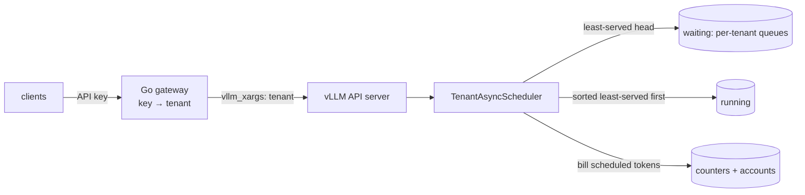

# Fair multi-tenant scheduling for vLLM

An out-of-tree scheduler plugin for **vLLM 0.31.0** that shares one GPU
between tenants by the service each has received, so one tenant's backlog
cannot starve another's interactive traffic. The policy is the Virtual Token
Counter (VTC) from Sheng et al., *Fairness in Serving Large Language Models*
(OSDI 2024). This repository is an implementation of it inside a production
engine. It also includes a small Go gateway that maps API keys to tenants,
and an open-arrival load generator.

The work here is the integration and the evaluation:
- where to hook a continuous-batching scheduler that has chunked prefill,
  async scheduling, prefix caching and KV-pressure preemption, without
  modifying vLLM;
- how to bill only the work that actually ran;
- a post-mortem of an earlier design that livelocked;
- three-seed experiments on an RTX 4090 that report VTC's costs as well as
  its wins.

**Noisy neighbour, Qwen2.5-7B.** Tenant A sends interactive requests. At t = 10 s
tenant B dumps 300 long requests. Values are ranges over 3 seeds:

| Tenant A time to first token | vLLM FCFS | vLLM priority (A marked high) | VTC |
|---|---|---|---|
| median | 32.4 – 40.5 s | 0.23 – 0.30 s | 0.39 – 0.50 s |
| p99 | 90.9 – 92.0 s | 0.78 s | 0.86 – 1.43 s |

Static priority does better here: A's median TTFT is about 1.7× lower than
under VTC (1.66–1.77× per seed), because priority was told who the
interactive tenant is. When the tenants are peers that knowledge does not
exist. Priority then gives one tenant everything, and VTC is the only arm
that splits the GPU evenly ([aggressive tenant](#aggressive-tenant)).

## How it works

The plugin subclasses vLLM's `AsyncScheduler` and loads with
`--scheduler-cls fairsched.TenantAsyncScheduler`. It hooks the scheduler in
three places ([docs/design.md](docs/design.md); the decisions and their costs
are in [docs/design-tradeoffs.md](docs/design-tradeoffs.md)):

1. **Admission.** `self.waiting` becomes a per-tenant queue. Each pop returns
   the oldest request of the least-served tenant, the one with the lowest
   virtual counter. A tenant that returns after its queue emptied is lifted
   to the lowest counter among backlogged tenants, as in the paper, so idle
   time cannot be banked.
2. **Token budget and preemption victim.** Before vLLM's native `schedule()`
   runs, the running list is sorted least-served first.
   - vLLM spends each step's token budget in that order.
   - Under KV pressure vLLM preempts `running[-1]`. That is now the newest
     request of whichever tenant is most over-served at that moment, which
     can be the light tenant right after a lift (see the costs below).
3. **Billing.** `_update_after_schedule` charges each tenant, before positions
   advance, for the tokens vLLM actually scheduled that step:
   - prefill tokens at weight 1, decode tokens at weight 2;
   - prefix-cache hits are never billed;
   - recompute after a preemption is detected from executed positions and
     billed to a separate `system` account;
   - steps of requests aborted while their step was on the GPU are
     reclassified as wasted.

The plugin never preempts a request on its own. An earlier design did, and
on a deliberately overloaded run with 6,144-token prompts it **livelocked**:
- no request produced a token before the 90 s client timeout;
- in the part of the run its step log covers, the policy preempted 678 times
  and 99.5% of the prefill tokens it dispatched recomputed positions already
  computed once.

Plain FCFS also timed out on that workload with the same limits, so the run
shows where the policy's work went, not that FCFS would have finished. [docs/livelock.md](docs/livelock.md) explains
why enforcing fairness below the size of one request destroys work.

## Results

**Setup**
- One RTX 4090, Qwen2.5-7B-Instruct BF16, vLLM 0.31.0 in its official
  container, with async scheduling and prefix caching.
- Engine limits: `--max-num-batched-tokens 2048`, `--max-num-seqs 128`, and
  84k tokens of KV.
- Load: the Go load generator replays seeded open-arrival traces through the
  gateway. Prompts are exact-length token IDs, and `ignore_eos` fixes output
  lengths.
- Every workload ran with 3 seeds. In `noisy_neighbor` and `long_prompt` the
  seed changes tenant A's Poisson arrival times (and, in `noisy_neighbor`,
  which of B's requests are cancelled). In `aggressive` and `weighted` the
  arrival schedule is fixed and the seed changes only the prompt token IDs.
  Tables give the range over seeds.
- Percentiles are nearest-rank over each run's completed requests. Where a
  tenant has fewer than 100 requests (A in `long_prompt` has 63–69), p99 is
  the maximum.
- Arms:
  - **FCFS:** vLLM's scheduler with the plugin in passthrough mode, so
    accounting and logging match the VTC arm;
  - **priority:** vLLM's native priority policy, with the gateway marking one
    tenant high;
  - **VTC.**
- "Share" is each tenant's fraction of billed service over the steps in
  which both tenants had work waiting.
- Per-run data is in `results/*/summary.json`
  ([results/README.md](results/README.md)). To rerun, see
  [Reproduce](#reproduce).

### Noisy neighbour

**Workload.**
- Tenant A: Poisson 2 req/s, 256-token prompts, 128 output tokens, for 120 s.
- Tenant B: at t = 10 s, 300 requests with 2,048-token prompts and 256 output
  tokens. The client cancels a random 20% of them after their second output
  chunk.

| | FCFS | Priority (A high) | VTC |
|---|---|---|---|
| A TTFT median | 32.4 – 40.5 s | 0.23 – 0.30 s | 0.39 – 0.50 s |
| A TTFT p99 | 90.9 – 92.0 s | 0.78 s | 0.86 – 1.43 s |
| B TTFT median | 45.7 – 46.3 s | 48.8 – 50.2 s | 49.1 – 50.2 s |
| B's burst finishes | 112 – 115 s | 114 – 116 s | 114 – 118 s |
| A requests preempted under KV pressure | 0 – 1 | 0 | 11 – 20 |

Under FCFS, A gets almost no service from t = 10 s until B's backlog drains
near t = 100 s. Under VTC, A is served at its demand throughout. B pays with
about 4 s more median TTFT, and its burst finishes 2–3 s later:

The preemption row is VTC's cost. Each time A's queue empties and a new
request arrives, the lift puts A level with B's counter. For a moment A can
be the most-served tenant, and its newest request becomes vLLM's KV-pressure
victim. That is where A's p99 above priority comes from.

### Aggressive tenant

**Workload.** Both tenants are backlogged from t = 0 with the same request
shape: 1,024-token prompts and 256 output tokens. A sends 100 requests and B
sends 300, three times the demand. The weights are equal.

| | FCFS | Priority (A high) | Priority (B high) | VTC |
|---|---|---|---|---|
| A : B share | 0.25 : 0.75 | 1.00 : 0.00 | 0.00 : 1.00 | **0.50 : 0.50** |
| A TTFT median / p99 | 32.7 / 72.2 s | 4.8 / 16.1 s | 61.1 / 72.3 s | 16.6 / 33.6 s |
| A's last request finishes | 78 s | 29 – 30 s | 78 – 79 s | 47 s |
| B's last request finishes | 78 – 79 s | 78 s | 69 s | 79 s |
| Output tokens/s (median) | 1,308 | 1,312 | 1,315 | 1,295 (−1.0%) |

TTFT cells are medians over the 3 seeds; no cell varied by more than 0.9 s
across seeds.
- **FCFS** serves each tenant in proportion to what it sends.
- **Static priority** is all or nothing between peers.
- **VTC** splits service evenly until A runs out of work, then gives B
  everything.

The 1.0% throughput cost matches the extra preemption recompute.
Alternating between two backlogged tenants churns the KV cache: VTC billed
68.0k–69.5k weighted tokens of recompute to `system`, against 59.4k–63.4k
for FCFS.

### Weighted shares

**Workload.** Each tenant has 200 identical requests backlogged from t = 0. A
has weight 2, B weight 1.

| | FCFS | VTC |
|---|---|---|
| A : B share | 0.50 : 0.50 | **0.67 : 0.33** (target 0.667) |
| A TTFT median | 32.6 – 33.4 s | 25.2 – 28.4 s |
| B TTFT median | 32.7 – 33.4 s | 56.3 – 58.0 s |
| Output tokens/s (median) | 1,304 | 1,278 (−2.0%) |

Here the cost is larger. VTC preempted 72–87 requests against FCFS's 68–70,
and recomputed 74.8k–90.3k weighted tokens against 59.4k–63.8k.

### Long prompts under KV pressure

**Workload.** Long prompts of the length that livelocked the earlier design
(on a different model, budget and KV size):
- Tenant B sends 6 requests with 6,144-token prompts at t = 0.
- Tenant A sends Poisson 1 req/s short requests.
- The KV cache is capped at 520 blocks (8,320 tokens), so one long request
  nearly fills it.

| | FCFS | VTC |
|---|---|---|
| B's six requests finish | 16.1 – 16.3 s | 16.1 – 16.3 s |
| A TTFT p99 | 10.3 – 12.8 s | **1.9 – 3.0 s** |
| Preemptions (all of tenant A) | 3 – 6 | **0** |
| Fewest free KV blocks during the run | 0 | 60 – 76 |

FCFS preempts the newest running request, which is A's fresh short request.
VTC orders admission so the cache never runs out, and B's long requests
finish at the same time. The earlier quantum-preemption design was not run
on this configuration.

### Scheduler overhead

`bench/hook_overhead.py` measures CPU time per `schedule()` +
`update_from_output()` call in the real vLLM scheduler, with a stubbed model
runner. Results are in `results/hook_overhead.jsonl`:

| Running requests | vLLM native | Plugin, passthrough | Plugin, VTC | Added per step |
|---|---|---|---|---|
| 64 | 406 µs | 532 µs | 538 µs | 132 µs |
| 128 | 785 µs | 1,035 µs | 1,029 µs | 244 µs |
| 256 | 1,681 µs | 2,150 µs | 2,083 µs | 403 µs |

- Almost all of the added time is in the hooks themselves: sorting
  `running`, billing and the per-step log. This is a single run, and the VTC
  decisions add nothing it can resolve on top of passthrough (VTC even came
  out below passthrough at 128 and 256 requests).
- At 128 running requests a Qwen2.5-7B decode step takes about 50 ms
  (median TPOT in these runs), so the plugin adds about 0.5%.
- With async scheduling this CPU time overlaps the previous step's GPU work.
- End-to-end throughput on the noisy-neighbour trace cannot show this
  overhead. The trace is open-loop, so its arrival schedule sets how long a
  run lasts and the trace sets how many tokens it produces: every arm's
  seed-1 run gives 730.6–731.2 output tokens/s, with no plugin, passthrough,
  priority and VTC alike. There is no run without the plugin on a
  saturating trace.

## Reproduce

Requirements: Linux with Docker and the NVIDIA Container Toolkit, one 24 GB
GPU (the results are from an RTX 4090), `nvidia-smi`, and Python 3.12 or
later on the host. The runner itself uses only the standard library; the
engine runs in the vLLM image pinned by digest in `configs/pins.json`, and Go
code builds in the pinned Go image.

1. **Models.** `scripts/fetch-models.sh` (or `make models`) downloads the
   pinned revision of Qwen2.5-7B-Instruct (about 15 GB) into
   `.cache/huggingface`. The engine container mounts that directory and runs
   with `HF_HUB_OFFLINE=1`, so the download must happen first.
2. **Binaries.** `scripts/build-go.sh` (or `make build`) builds
   `bin/fairsched-proxy` and `bin/fairsched-loadgen`, which the runner starts
   for every run.
3. **Plots.** `scripts/run-all.sh` draws the figures with `.venv/bin/python`:
   `python3 -m venv .venv && .venv/bin/pip install matplotlib==3.11.2`
   (`make .venv/bin/python`).
4. **Runs.** `scripts/run-all.sh` (or `make bench`) runs every experiment
   above, about 2.5 h. A single run is
   `python3 -m bench.run noisy_neighbor vtc --seed 1`. Each run waits for an
   exclusive `flock` on `/var/tmp/rtx4090.lock` (`FAIRSCHED_GPU_LOCK`), refuses
   to start while another process holds more than 1 GiB of GPU memory, starts
   its own engine with `--gpu-memory-utilization 0.83`, and writes raw output
   to `results/raw/<workload>/<arm>-s<seed>/`. It never overwrites an existing
   run directory.
5. **Summaries.** `python3 -m bench.report <workload> ... [--plots]` rewrites
   `results/<workload>/summary.json` (and the PNGs) from the raw runs.

## Testing

`scripts/test.sh` (or `make test`) runs three suites, in this order. The
first two need no model; the third needs the test model's `config.json`,
which `scripts/fetch-models.sh --test-only` (`make test-model`) fetches.
`make test-local` runs the first two without Docker, using a local Go
toolchain.

- **Policy, report and step log** (`tests/test_policy.py`,
  `tests/test_report.py`, `tests/test_audit.py`, pure Python): the lift rule
  (waiting queue only), weighted shares, recompute and waste attribution,
  unlisted tenants, queue semantics matching vLLM's `FCFSRequestQueue`, the
  report's percentiles, shares and timelines, and dropped-record reporting.
- **Go** (`go test ./...`): the gateway's header stripping and tenant
  injection, streaming, cancellation, and the load generator.
- **Real vLLM scheduler on CPU** (`tests/test_scheduler_vllm.py`), in the
  pinned container with no GPU. It builds the real vLLM 0.31.0
  `AsyncScheduler`, KV cache manager, block pool and prefix cache, replaces
  only the model forward pass, and checks:
  - a tenant arriving behind a 16k-token backlog (eight 2,048-token prompts)
    gets its first token within 6 steps; under FCFS it takes at least 25;
  - under KV pressure only the over-served tenant is preempted, where native
    FCFS preempts the newly arrived tenant;
  - with three 6,144-token prompts and ten short requests in a small KV
    cache, every request finishes and none is preempted more than twice;
  - recompute is billed to `system`;
  - aborting a request with a step in flight marks exactly that step's tokens
    as wasted;
  - prefix-cache hits are not billed;
  - 2:1 weights give a 2:1 split.

## Repository layout

| Path | What it is |
|---|---|
| `fairsched/scheduler.py` | the vLLM scheduler plugin (the three hooks) |
| `fairsched/policy.py` | VTC counters, lift rule, cost model, accounts |
| `fairsched/queue.py` | per-tenant waiting queue behind vLLM's `RequestQueue` interface |
| `fairsched/audit.py` | per-step JSONL log |
| `proxy/`, `cmd/fairsched-proxy` | Go gateway: API key → tenant, trusted `vllm_xargs`, streaming, cancellation |
| `loadgen/`, `cmd/fairsched-loadgen` | Go open-arrival load generator with per-chunk timestamps |
| `bench/` | workloads, experiment runner, report, plots, hook overhead |
| `docs/` | [design](docs/design.md), [design trade-offs](docs/design-tradeoffs.md), [livelock post-mortem](docs/livelock.md) |

## Limitations

- The plugin hooks vLLM internals, so it is pinned to vLLM 0.31.0. The CPU
  scheduler tests are the upgrade check.
- Single engine and GPU. Counters live in memory and reset when the engine
  restarts.
- It refuses to run with speculative decoding, LoRA or KV connectors.
- The cost model is VTC's linear one, with weights 1 for prefill and 2 for
  decode. It does not model attention cost growing with context length.
- Fairness acts on admission and token-budget order. A request already
  running a very long prefill keeps its chunks going. VTC accepts that
  bound in exchange for never throwing away work.
- Under KV pressure the light tenant can be the victim, as the noisy-neighbour
  results show.
