# Design

## Goal

One vLLM instance is shared by several tenants: an interactive assistant, a
batch job, a team that floods the endpoint. vLLM's own policies give you FCFS
or static priorities. Under FCFS, a tenant that submits 300 requests at once
delays everyone else's next request by minutes. Under static priority, the
lower class can starve indefinitely.

This plugin makes vLLM share the GPU by **service received**. It uses the
Virtual Token Counter algorithm (VTC; Sheng et al., *Fairness in Serving Large
Language Models*, OSDI 2024). The algorithm is not new. The work here is
making it correct inside vLLM V1's real scheduler, where four things
complicate it: asynchronous scheduling, chunked prefill, prefix caching, and
preemption. The plugin also keeps an exact record of who paid for what.

Non-goals are multi-GPU, speculative decoding, LoRA, and KV connectors. The
plugin refuses to start with any of them.

## Where it hooks into vLLM

```mermaid
flowchart LR
  C[clients] -->|API key| G[Go gateway<br/>key → tenant, injects vllm_xargs]
  G -->|OpenAI API, streamed| E[vLLM API server]
  E --> S
  subgraph S[EngineCore: TenantAsyncScheduler]
    direction TB
    W[waiting:<br/>TenantRequestQueue] -->|pop least-served head| N[native schedule&#40;&#41;]
    R[running: sorted<br/>least-served first] --> N
    N -->|_update_after_schedule| B[bill scheduled tokens]
    N -->|KV full: preempt running&#91;-1&#93;| W
    O[update_from_output] -->|aborted with step in flight| X[mark wasted]
  end
```

The plugin subclasses `AsyncScheduler` (and `Scheduler` for the synchronous
control). vLLM loads it with `--scheduler-cls fairsched.TenantAsyncScheduler`.
vLLM's source is not modified. Because the plugin touches internals,
`fairsched` refuses to load on any vLLM other than 0.31.0, and
`tests/test_scheduler_vllm.py` runs the real scheduler loop in the pinned
container to catch interface drift.

| Hook | What it does |
|---|---|
| `self.waiting = TenantRequestQueue(...)` | Admission. A queue per tenant; `peek`/`pop` return the oldest request of the least-served tenant. It implements all ten `RequestQueue` operations with the same prepend/remove semantics as `FCFSRequestQueue`. |
| `schedule()` | Sorts `self.running` by tenant counter before calling the native `schedule()`. |
| `_update_after_schedule()` | Bills the tokens the native scheduler actually scheduled this step. |
| `update_from_output()` | Reclassifies work for requests that ended while their step was on the GPU. |
| `_preempt_request()` | Counts KV-pressure preemptions per tenant. |
| `_free_request()` | Drops the finished request's admission reservation and queues its metadata for release once no in-flight step bills it. Whether a tenant is idle is decided by its waiting queue, not here. |

## VTC in one paragraph

Each tenant *t* has a counter *c_t* of weighted service received, divided by
the tenant's weight. A step that runs *p* prefill tokens and *d* decode tokens
for tenant *t* adds `(w_p·p + w_d·d) / weight_t` to *c_t*. The defaults are
`w_p = 1` and `w_d = 2`, as in the paper. They are not this GPU's costs: a
step-time fit on the logged work puts a decode token at 0.97–1.71× a prefill
token, depending on the workload
([README](../README.md#different-request-shapes-and-what-a-token-costs)).
Admission always serves the backlogged
tenant with the smallest counter. When a tenant goes from idle to backlogged,
its counter is **lifted** to the smallest counter among backlogged tenants, or
to the last departing tenant's counter if nobody is backlogged. Without the
lift, a tenant that sat idle for an hour could monopolise the GPU when it
returned. The paper proves that, between any two backlogged tenants, the
service gap stays within a bound set by the batch's token budget and the
largest request.

## How fairness reaches the GPU in vLLM V1

vLLM V1 runs one loop per step. It first schedules every **running** request
until the token budget (`--max-num-batched-tokens`) is spent. Only then does
it admit **waiting** requests into whatever budget and KV blocks are left.
When a running request cannot get a new KV block, it preempts `running[-1]`
(FCFS) and retries.

The plugin uses both phases without adding a decision point of its own:

* **Running order.** Sorting `running` least-served-first means the step's
  budget goes to under-served tenants first. An over-served tenant's request
  that misses the budget simply waits a step. It keeps its KV blocks, so no
  work is lost.
* **Preemption victim.** After the sort, `running[-1]` is the newest request
  of the tenant that is most over-served at that moment, so vLLM's own
  KV-pressure preemption takes from the tenant that can best afford it. That
  is not always the heavy tenant. The lift rule (below) restarts a returning
  tenant at the lowest backlogged counter, so a light tenant that keeps
  coming back can briefly lead, and then its newest request is the victim. In
  the noisy-neighbour runs the interactive tenant lost 8–20 requests this way
  (the heavy tenant 23–33); under FCFS it lost 0–8, under static priority 0.
  The policy option `preempt_order: "kv_share"` instead moves tenants that
  hold more than their weighted share of the running requests' KV (computed
  tokens) to the back, keeping counter order within each group, so the
  victim comes from them. In the noisy-neighbour runs it took the
  interactive tenant's preemptions to 0 and the heavy tenant's up by 4–8,
  without changing the interactive tenant's TTFT.
* **Admission.** The tenant queue decides which waiting request gets the
  leftover budget. Each admission *reserves* the request's remaining prefill
  cost on its tenant's counter for the rest of the step. Without that, one
  tenant's ten queued requests could all be admitted in the same step before
  any of them was billed.

The plugin never preempts a request on its own. An earlier version did, and
it livelocked. See [livelock.md](livelock.md).

## Billing what actually ran

`_update_after_schedule` runs inside `schedule()`, after the scheduler has
built its output and before the native code advances `num_computed_tokens`.
At that moment, for each scheduled request, positions
`[num_computed_tokens, num_computed_tokens + n)` are exactly the positions
the GPU will execute this step:

* **Prefix-cache hits are free.** When vLLM finds a cached prefix it has
  already advanced `num_computed_tokens` past it. Those positions are never
  scheduled, so they are never billed (`test_prefix_cache_hits_are_not_billed`).
* **Prefill and decode split by position.** Positions below
  `num_prompt_tokens` are prefill; the rest are decode. A chunked prefill is
  billed chunk by chunk, in the step that runs each chunk.
* **Recompute is detected, not guessed.** The plugin keeps an interval set of
  positions each request has executed. After a preemption, vLLM resets the
  request to position 0, and any re-executed position overlaps that set.
  Recompute is billed to a separate `system` account by default
  (`charge_recompute`). Re-executing the prompt is the engine's choice, so the
  tenant is not charged twice for the same tokens.

The scheduler holds two separate ledgers on purpose:

* **Counters** drive decisions. They are the scheduling history and are never
  rewritten.
* **Accounts** answer "who paid for this GPU time": each tenant, plus
  `system`. When the plugin later learns that some work was wasted, it moves
  cost between accounts but leaves the counters alone. Editing the counters
  would retroactively change decisions that were already made.

## Asynchronous scheduling

vLLM's default `AsyncScheduler` schedules step N+1 while step N is still
running on the GPU. `update_from_output` for step N arrives one call later,
and two things can happen in that gap:

* A client disconnects. The gateway cancels the upstream request and vLLM
  finishes it as `FINISHED_ABORTED`, while a step that includes it is already
  on the GPU. That step's tokens for the request are useless.
* A request reaches `max_tokens` or EOS in step N, but step N+1 has already
  scheduled one more decode token for it.

The plugin keeps each step's charge records in a ledger keyed by the
`SchedulerOutput` object. When the output lands, any record whose request is
gone or finished is marked **wasted**. The marking is idempotent, and
`charge_wasted` decides whether the tenant or `system` pays for the waste.
The ledger and per-request metadata are released only when no in-flight step
still refers to them (`test_abort_with_step_in_flight_marks_its_tokens_wasted`).

## Gateway and load generator (Go)

The gateway (`proxy/`, `cmd/fairsched-proxy`) maps API keys to tenants. It strips
every client-supplied `fairsched*`, `vllm_xargs` and `priority` field at the
top level of the body (and in a top-level `extra_body`), where vLLM reads
them, and leaves nested content such as tool schemas alone. It injects a
trusted `vllm_xargs` carrying the tenant. It
always streams from the engine. It cancels the upstream request when the
client disconnects, so cancellation reaches vLLM's abort path. It logs one
terminal record per request.

The gateway rejects unknown API keys (HTTP 401), and its configuration only
accepts keys that map to a configured tenant. A request can still reach the
engine with a tenant the plugin's policy does not list: the gateway and the
policy may list different tenants, or a client may call vLLM directly. The
plugin serves such a request as the `default` tenant (weight 1 unless the
policy lists `default`) instead of failing vLLM's `add_request`, and the step
log counts these requests in `unknown_requests`. All of them share that one
tenant, so inventing tenant names gains no extra share.

The load generator (`loadgen/`, `cmd/fairsched-loadgen`) replays open-arrival
traces. Requests are sent at their scheduled time whether or not earlier ones
have finished, so queueing shows up in latency instead of being hidden by a
closed loop. It records per-chunk receipt times, so TTFT is measured from the
scheduled arrival.

## Observability

Every scheduled step appends one JSON line to `steps-<pid>.jsonl`. A line
records, per tenant:
* scheduled prefill, decode and recompute tokens;
* counters, accounts and wasted cost;
* running and waiting counts and preemptions;

plus the step's free KV blocks and the wall time of the whole `schedule()`
call. A bounded queue and a writer thread keep disk I/O off the scheduling
thread. If the writer falls behind, records are counted as dropped instead of
stalling the engine, and the next record that gets through carries the
running total as `dropped`. `bench/report.py` turns these lines into the
service timelines in the README.

## Limitations

* The plugin is pinned to vLLM 0.31.0 internals: `running`/`waiting`, the
  hook names, and `num_computed_tokens` semantics. Each upgrade needs the
  compatibility tests rerun.
* A single engine and a single GPU. Counters live in memory and reset when
  the engine restarts.
* The cost model is the paper's linear `w_p`/`w_d`. It does not model
  attention cost growing with context length.
* Running requests are always scheduled before waiting ones (that is vLLM's
  loop). A request that is already running a very long prefill can hold most
  of a step's budget until its chunks finish. vLLM's
  `--long-prefill-token-threshold` caps the chunk per request if that
  matters.
